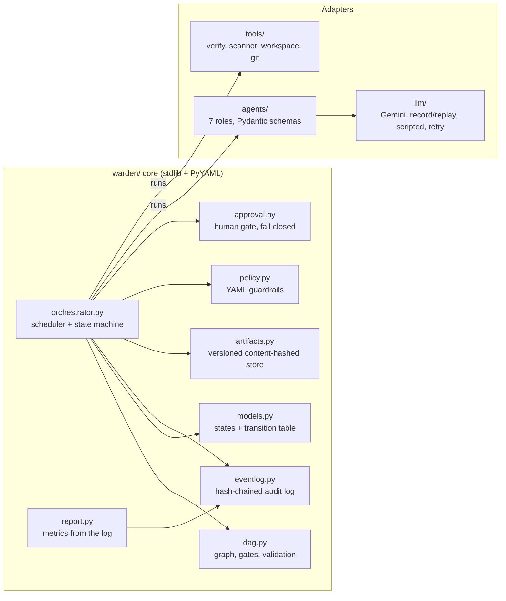
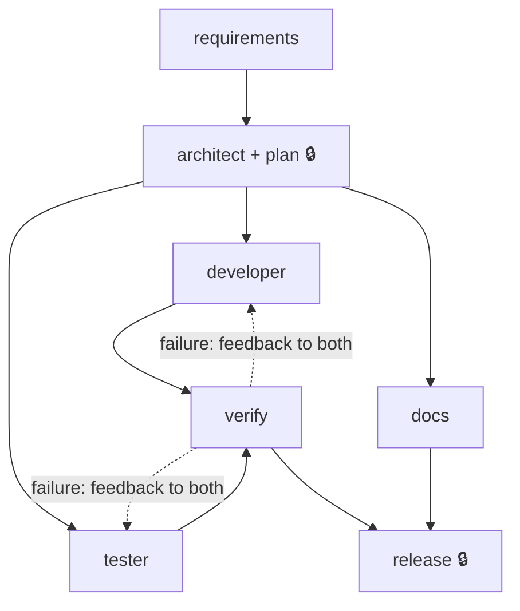
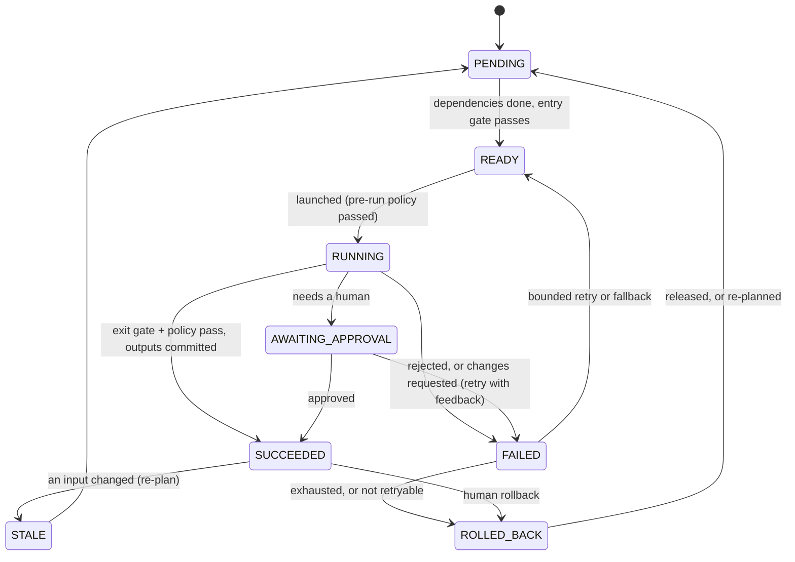

# Architecture

Warden is an in-process orchestrator that runs an SDLC workflow as an explicit dependency graph.
Agents produce work. The orchestrator decides what runs, what gets committed, and when a human
must decide. Every decision is written to a hash-chained audit log.

## Components

| Component | Responsibility |
|---|---|
| `models.py` | Node and run states plus the **legal transition table**, the single source of truth. Any other transition raises. |
| `dag.py` | `NodeSpec` (dependencies, consumed and produced artifacts, entry and exit gates, approval, retries, fallback, failure re-plan targets) and `Graph`, which is validated at construction: no cycles, every artifact has one producer, and consumers only read artifacts produced upstream (this keeps parallel branches safe). |
| `orchestrator.py` | Scheduler. It runs ready nodes in parallel on a thread pool, but **only the scheduler thread changes node state**. It handles retries, fallback, repair loops, rollback, safe-stop, re-planning, brownfield `adopt()`, and resume after a crash. |
| `artifacts.py` | Versioned store keyed by SHA-256. Each artifact records the hashes of the inputs it was built from, so `stale()` and re-planning know exactly what changed. Writing identical content is a no-op, which is how unchanged outputs stop a cascade. |
| `eventlog.py` | Append-only JSONL. Each event holds the previous event's hash, so editing, deleting or reordering a line fails `verify()`. `caused_by` links give decision lineage. |
| `policy.py` + `policies/default.yaml` | Pre-run and post-run guardrails: secrets, compliance (personal data), dependency allowlist, protected paths, and autonomy per role. Loading fails closed on any malformed rule. |
| `approval.py` | Human gate. The default approver **rejects everything**, so with no human connected nothing that needs approval can proceed. |
| `agents/` | Requirements, Impact, Architect (which also plans), Developer, Tester, Docs and Release. Each validates JSON output against a strict schema plus cross-artifact checks, with one repair round. |
| `llm/` | One `LLMClient` interface, with backends for Gemini (httpx), record/replay, scripted answers and bounded backoff. Errors are classified as transient, quota or permanent. |
| `tools/` | Verify (stack commands on a scratch copy), codebase scanners (Python `ast`, C# patterns), workspace writer, command runner with a scrubbed environment, git, publish. |
| `stacks.py` | Stack profiles for generated projects: prompt overrides per role, file-ownership rules, in-agent syntax check, verify commands, scanner. `dotnet-aspnetcore` (ASP.NET Core + EF Core + xUnit) and `python-fastapi`. |
| `report.py` | Computes metrics and the Markdown report from the audit log alone. |

## Orchestration model

### Workflows

Brownfield adds `scan → requirements → impact 🔒 → architect` in front. The scanner and the impact
analysis read an immutable snapshot of the existing repo, while the agents revise its files.
🔒 marks approval set on the graph itself; the policy engine can add more gates but never remove
these.

### Node state machine

### Control flow of one attempt

1. **Entry gate:** dependencies have SUCCEEDED, consumed artifacts exist, and the node's entry
   gate (if any) passes. Otherwise the node waits, or is reported as blocked.
2. **Pre-run policy:** for example, a role with autonomy `none` is denied before an agent runs.
3. **Agent runs** in a worker thread and returns **staged** outputs. Agents never write to the store.
4. **Exit gate:** checks for missing or undeclared outputs, then runs the node's own gate (verify
   uses this for test and lint results).
5. **Stale-input check:** if an input changed while the agent was working, the result is discarded
   and the node re-queued.
6. **Post-run policy** on every output file, including files inside bundles: deny (secrets,
   personal data, unlisted dependencies, malformed bundle) or escalate (protected path,
   `supervised` role).
7. **Approval** if the graph, the policy or the agent asks for it. The agent can only *add*
   oversight. Approve leads to commit; reject fails the node without retry; "changes" sends the
   comment back as feedback for a retry.
8. **Commit:** outputs go to the artifact store with input hashes. Content that actually changed
   triggers re-planning of the nodes that consume it.

**Failure handling** is bounded at every level:

| Level | Mechanism | Bound |
|---|---|---|
| Model call | `RetryingClient`: backoff on rate limits, timeouts and 5xx | 4 attempts; a quota longer than 60s is not retried |
| Agent output | Schema or check errors fed back to the model | 1 repair round |
| Node | Retry, then the fallback agent | `max_retries` (2), then one fallback |
| Workflow | Failure routed upstream (verify → developer + tester) | `max_replans` (4) |
| Run | Rollback and halt, or safe-stop (kill switch or step budget) | — |

These failures are never retried (CLAUDE.md rule 4):
- policy denials
- human rejections
- `PermanentAgentError` (daily quota, replay miss)

## Governance

| Guardrail | Where | Example |
|---|---|---|
| Security | policy `secrets` | Hard-coded AWS key → deny. The reason names the file and line, never the value |
| Compliance | policy `compliance` | SSN or payment card (Luhn-checked) in a test fixture → deny |
| Supply chain | policy `dependencies` | Unlisted package in `requirements.txt` or `*.csproj` (NuGet `PackageReference`), pip options, direct URLs → deny |
| Change control | policy `protected_paths` | `requirements*.txt`, `*.csproj`, `appsettings*.json`, `Migrations/`, `.github/*`, `policies/*` → human approval |
| Scope | policy `scope` | The developer may write only what the approved design (or brownfield impact analysis) contains, plus scaffolding; anything else stops for a human with the files named |
| Controlled autonomy | policy `autonomy` per role | architect, impact, release: `supervised`; developer: `full`; unknown roles: `supervised` |
| Human checkpoints | graph `requires_approval` | Architect and release always; spec for vague requests; impact for brownfield |
| Execution safety | `tools/runner.py` | Generated code runs with an allowlisted environment (no keys) and a timeout |
| Audit | `eventlog.py`, `tools/git.py` | Hash chain + `caused_by` lineage; the head hash is anchored in each published git commit, so even a full log rewrite is detected. The report traces the release back to every human decision and checks the anchors |

## Key decisions

| Decision | Choice | Why | Alternatives |
|---|---|---|---|
| Orchestration | Own scheduler over an explicit DAG with a transition table | The brief grades the orchestrator; governance needs every transition visible and enforced | LangGraph, Temporal, Airflow: more machinery, less control over the governance semantics |
| Concurrency | Thread pool for agents, a single scheduler thread for state | Parallel I/O-bound agents without locks on node state | asyncio (fine, but no gain for blocking HTTP and subprocess calls) |
| Commit model | Agents return staged outputs; the orchestrator commits after gates, policy and approval | A failed or discarded attempt has nothing to undo | Agents writing directly, which needs compensation logic |
| Lineage | Content-hashed artifacts with input hashes | Precise re-planning; unchanged outputs stop cascades | Timestamps or version counters (over-invalidate) |
| Audit | Hash-chained JSONL with `caused_by` | Tamper-evident and readable with standard tools | A database (heavier; same evidence) |
| Many files per agent | One `*.bundle` artifact, expanded for policy checks | Nodes declare outputs up front; file names are not known in advance | Dynamic outputs (break graph validation) |
| LLM determinism | Record/replay keyed by request hash, with the n-th repeat recorded separately | Reviewers run offline; retries still get fresh answers | Mocking (proves less), always live (cost, flakiness) |
| Model | gemini-3.8-flash behind one interface | Free tier for development; swappable | Any provider fits `LLMClient` |
| Dependencies | Standard library in core; PyYAML for policy; httpx and Pydantic only in adapters | Small trusted core, enforced by a test | — |
| Generated stack | Stack profiles; .NET (ASP.NET Core + xUnit) by default for new projects | The engine stays stack-agnostic; .NET matches the target role; Python kept so recorded runs stay valid | Hard-coding one stack; rewriting the engine in C# |
| Generated output | A normal git repo, one commit per feature, rollback by `git revert` | Humans continue the code without Warden | Keeping output inside Warden's store |

More rationale, risks and limitations: [ENGINEERING_SUMMARY.md](ENGINEERING_SUMMARY.md).
