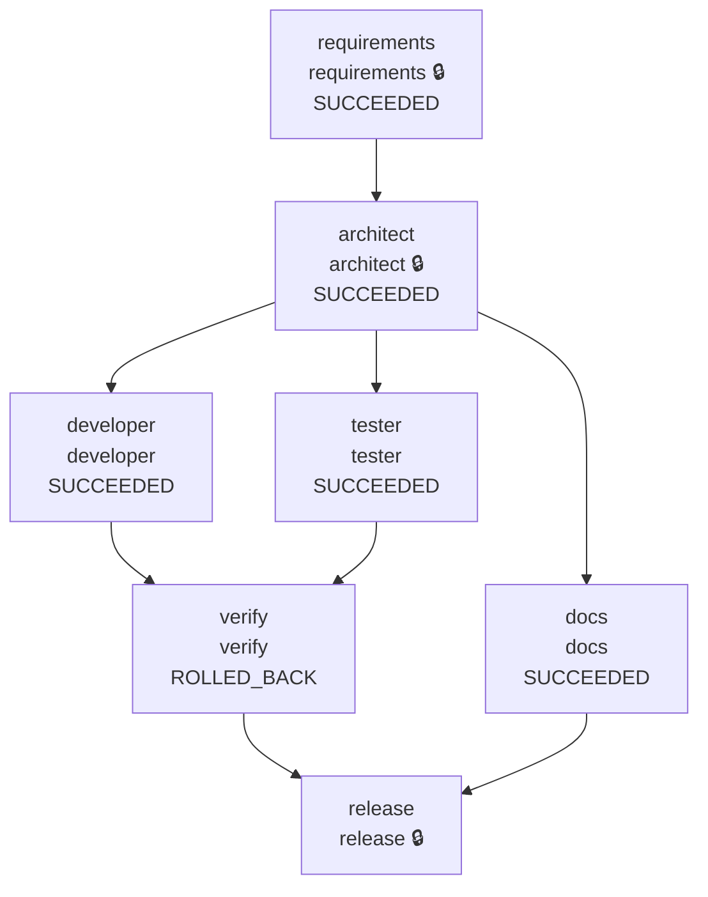

# Warden run report: ambiguous (recorded with Gemini, new prompts live)

## Summary

| Run | State | End-to-end latency | Agent executions | Reason |
|---|---|---|---|---|
| ambiguous-20261012T221026Z | FAILED | 232.808s | 26 | verify: exit gate: tests failed (exit 1): Tests: 26 total, 0 passed, 26 failed. Failures grouped by error (most frequent first): - 26 tes... |

## Reliability metrics

| Metric | Value |
|---|---|
| Run success rate | 0% |
| Agent attempts | 26 |
| Attempt success rate | 65% |
| Failed attempts | 9 |
| Retries (rate per attempt) | 2 (8%) |
| Fallbacks to a backup agent | 0 |
| Rollbacks (per run) | 1 (1) |
| Repair loops (failure routed upstream) | 6 |
| Incidents recovered / unrecovered | 2 / 1 |
| MTTR (first failure -> recovery) | 92.417s |
| Policy denials / escalations | 0 / 15 |
| Audit events | 257 |

## Model usage and cost

| Node | Calls | Input tokens | Output tokens | Thinking tokens | Est. cost |
|---|---|---|---|---|---|
| requirements | 2 | 1,878 | 3,582 | 2,333 | $0.0236 |
| architect | 2 | 8,288 | 4,447 | 475 | $0.0247 |
| developer | 10 | 168,915 | 121,081 | 145,740 | $1.1273 |
| tester | 8 | 108,964 | 72,634 | 60,525 | $0.5811 |
| docs | 1 | 6,136 | 5,802 | 0 | $0.0264 |
| **total** | 23 | 294,181 | 207,546 | 209,073 | $1.7830 |

Models: gemini-3.8-flash. Cost estimated at list prices in `warden/llm/pricing.py`.
2 call(s) have no thinking-token count (recorded before it was captured), so their cost is understated.

## Workflow

Final state of every node (🔒 = human approval required).

| Node | Final state | Attempts | Failures | Last duration |
|---|---|---|---|---|
| requirements | SUCCEEDED | 2 | 1 | 0 ms |
| architect | SUCCEEDED | 1 | 0 | 31 ms |
| developer | SUCCEEDED | 8 | 1 | 184796 ms |
| tester | SUCCEEDED | 7 | 0 | 0 ms |
| docs | SUCCEEDED | 1 | 0 | 15 ms |
| verify | ROLLED_BACK | 7 | 7 | n/a |

## Timeline

| t | Node | Event | Detail |
|---|---|---|---|
| +0.0s | - | RUN_STARTED |  |
| +0.0s | requirements | READY -> RUNNING | requirements |
| +0.0s | requirements | RUNNING -> AWAITING_APPROVAL |  |
| +0.0s | requirements | approval: changes | human:product-owner (scripted) Answers from the product owner (scripted for reproducible demos; in interactive mode you type your own): -... |
| +0.0s | requirements | AWAITING_APPROVAL -> FAILED | changes requested by product-owner (scripted): Answers from the product owner (scripted for reproducible demos; in interactive mode you t... |
| +0.0s | requirements | RETRY_SCHEDULED | changes requested by product-owner (scripted): Answers from the product owner (scripted for reproducible demos; in interactive mode you t... |
| +0.0s | requirements | READY -> RUNNING | requirements |
| +0.0s | requirements | RUNNING -> AWAITING_APPROVAL |  |
| +0.0s | requirements | approval: approve | human:auto-approve --auto-approve |
| +0.0s | requirements | AWAITING_APPROVAL -> SUCCEEDED |  |
| +0.0s | architect | READY -> RUNNING | architect |
| +0.1s | architect | policy escalate | role 'architect' has autonomy 'supervised' |
| +0.1s | architect | RUNNING -> AWAITING_APPROVAL |  |
| +0.1s | architect | approval: approve | human:auto-approve --auto-approve |
| +0.1s | architect | AWAITING_APPROVAL -> SUCCEEDED |  |
| +0.1s | developer | READY -> RUNNING | developer |
| +0.1s | tester | READY -> RUNNING | tester |
| +0.1s | docs | READY -> RUNNING | docs |
| +0.1s | developer | policy escalate | code.bundle:src/App/App.csproj matches protected path '*.csproj'; code.bundle:src/App/appsettings.json matches protected path '*appsettin... |
| +0.1s | developer | RUNNING -> AWAITING_APPROVAL |  |
| +0.1s | developer | approval: approve | human:auto-approve --auto-approve |
| +0.1s | developer | AWAITING_APPROVAL -> SUCCEEDED |  |
| +0.1s | tester | policy escalate | tests.bundle:tests/Tests.csproj matches protected path '*.csproj' |
| +0.1s | tester | RUNNING -> AWAITING_APPROVAL |  |
| +0.1s | tester | approval: approve | human:auto-approve --auto-approve |
| +0.1s | tester | AWAITING_APPROVAL -> SUCCEEDED |  |
| +0.1s | docs | RUNNING -> SUCCEEDED |  |
| +0.1s | verify | READY -> RUNNING | verify |
| +5.9s | verify | RUNNING -> FAILED | exit gate: build failed (exit 1): ./tests/R6_RedirectionTests.cs(19,81): error CS0234: The type or namespace name 'WebApplicationClientOp... |
| +5.9s | verify | FAILED -> ROLLED_BACK | exit gate: build failed (exit 1): ./tests/R6_RedirectionTests.cs(19,81): error CS0234: The type or namespace name 'WebApplicationClientOp... |
| +5.9s | verify | REPLAN | exit gate: build failed (exit 1): ./tests/R6_RedirectionTests.cs(19,81): error CS0234: The type or namespace name 'WebApplicationClientOp... |
| +5.9s | developer | READY -> RUNNING | developer |
| +5.9s | tester | READY -> RUNNING | tester |
| +5.9s | developer | policy escalate | code.bundle:src/App/App.csproj matches protected path '*.csproj'; code.bundle:src/App/appsettings.json matches protected path '*appsettin... |
| +5.9s | developer | RUNNING -> AWAITING_APPROVAL |  |
| +5.9s | developer | approval: approve | human:auto-approve --auto-approve |
| +5.9s | developer | AWAITING_APPROVAL -> SUCCEEDED |  |
| +6.0s | tester | policy escalate | tests.bundle:tests/Tests.csproj matches protected path '*.csproj' |
| +6.0s | tester | RUNNING -> AWAITING_APPROVAL |  |
| +6.0s | tester | approval: approve | human:auto-approve --auto-approve |
| +6.0s | tester | AWAITING_APPROVAL -> SUCCEEDED |  |
| +6.0s | verify | READY -> RUNNING | verify |
| +14.4s | verify | RUNNING -> FAILED | exit gate: tests failed (exit 1): Tests: 26 total, 1 passed, 25 failed. Failures grouped by error (most frequent first): - 25 test(s): Cl... |
| +14.4s | verify | FAILED -> ROLLED_BACK | exit gate: tests failed (exit 1): Tests: 26 total, 1 passed, 25 failed. Failures grouped by error (most frequent first): - 25 test(s): Cl... |
| +14.5s | verify | REPLAN | exit gate: tests failed (exit 1): Tests: 26 total, 1 passed, 25 failed. Failures grouped by error (most frequent first): - 25 test(s): Cl... |
| +14.5s | developer | READY -> RUNNING | developer |
| +14.5s | tester | READY -> RUNNING | tester |
| +14.5s | developer | policy escalate | code.bundle:src/App/App.csproj matches protected path '*.csproj'; code.bundle:src/App/appsettings.json matches protected path '*appsettin... |
| +14.5s | developer | RUNNING -> AWAITING_APPROVAL |  |
| +14.5s | developer | approval: approve | human:auto-approve --auto-approve |
| +14.5s | developer | AWAITING_APPROVAL -> SUCCEEDED |  |
| +14.5s | tester | policy escalate | tests.bundle:tests/Tests.csproj matches protected path '*.csproj' |
| +14.5s | tester | RUNNING -> AWAITING_APPROVAL |  |
| +14.5s | tester | approval: approve | human:auto-approve --auto-approve |
| +14.5s | tester | AWAITING_APPROVAL -> SUCCEEDED |  |
| +14.5s | verify | READY -> RUNNING | verify |
| +18.6s | verify | RUNNING -> FAILED | exit gate: build failed (exit 1): ./src/App/Services/TestingCompatibility.cs(66,11): error CS8954: Source file can only contain one file-... |
| +18.6s | verify | FAILED -> ROLLED_BACK | exit gate: build failed (exit 1): ./src/App/Services/TestingCompatibility.cs(66,11): error CS8954: Source file can only contain one file-... |
| +18.6s | verify | REPLAN | exit gate: build failed (exit 1): ./src/App/Services/TestingCompatibility.cs(66,11): error CS8954: Source file can only contain one file-... |
| +18.6s | developer | READY -> RUNNING | developer |
| +18.6s | tester | READY -> RUNNING | tester |
| +18.7s | developer | policy escalate | code.bundle:src/App/App.csproj matches protected path '*.csproj'; code.bundle:src/App/appsettings.json matches protected path '*appsettin... |
| +18.7s | developer | RUNNING -> AWAITING_APPROVAL |  |
| +18.7s | developer | approval: approve | human:auto-approve --auto-approve |
| +18.7s | developer | AWAITING_APPROVAL -> SUCCEEDED |  |
| +18.7s | tester | policy escalate | tests.bundle:tests/Tests.csproj matches protected path '*.csproj' |
| +18.7s | tester | RUNNING -> AWAITING_APPROVAL |  |
| +18.7s | tester | approval: approve | human:auto-approve --auto-approve |
| +18.7s | tester | AWAITING_APPROVAL -> SUCCEEDED |  |
| +18.7s | verify | READY -> RUNNING | verify |
| +27.5s | verify | RUNNING -> FAILED | exit gate: tests failed (exit 1): Tests: 26 total, 1 passed, 25 failed. Failures grouped by error (most frequent first): - 25 test(s): Cl... |
| +27.5s | verify | FAILED -> ROLLED_BACK | exit gate: tests failed (exit 1): Tests: 26 total, 1 passed, 25 failed. Failures grouped by error (most frequent first): - 25 test(s): Cl... |
| +27.5s | verify | REPLAN | exit gate: tests failed (exit 1): Tests: 26 total, 1 passed, 25 failed. Failures grouped by error (most frequent first): - 25 test(s): Cl... |
| +27.5s | developer | READY -> RUNNING | developer |
| +27.5s | tester | READY -> RUNNING | tester |
| +27.5s | developer | policy escalate | code.bundle:src/App/App.csproj matches protected path '*.csproj'; code.bundle:src/App/appsettings.json matches protected path '*appsettin... |
| +27.5s | developer | RUNNING -> AWAITING_APPROVAL |  |
| +27.5s | developer | approval: approve | human:auto-approve --auto-approve |
| +27.5s | developer | AWAITING_APPROVAL -> SUCCEEDED |  |
| +27.5s | tester | policy escalate | tests.bundle:tests/Tests.csproj matches protected path '*.csproj' |
| +27.5s | tester | RUNNING -> AWAITING_APPROVAL |  |
| +27.5s | tester | approval: approve | human:auto-approve --auto-approve |
| +27.5s | tester | AWAITING_APPROVAL -> SUCCEEDED |  |
| +27.5s | verify | READY -> RUNNING | verify |
| +37.0s | verify | RUNNING -> FAILED | exit gate: tests failed (exit 1): Tests: 26 total, 18 passed, 8 failed. Failures grouped by error (most frequent first): - 7 test(s): Mic... |
| +37.0s | verify | FAILED -> ROLLED_BACK | exit gate: tests failed (exit 1): Tests: 26 total, 18 passed, 8 failed. Failures grouped by error (most frequent first): - 7 test(s): Mic... |
| +37.0s | verify | REPLAN | exit gate: tests failed (exit 1): Tests: 26 total, 18 passed, 8 failed. Failures grouped by error (most frequent first): - 7 test(s): Mic... |
| +37.0s | developer | READY -> RUNNING | developer |
| +37.0s | tester | READY -> RUNNING | tester |
| +37.2s | developer | policy escalate | code.bundle:src/App/App.csproj matches protected path '*.csproj'; code.bundle:src/App/appsettings.json matches protected path '*appsettin... |
| +37.2s | developer | RUNNING -> AWAITING_APPROVAL |  |
| +37.2s | developer | approval: approve | human:auto-approve --auto-approve |
| +37.2s | developer | AWAITING_APPROVAL -> SUCCEEDED |  |
| +37.2s | tester | policy escalate | tests.bundle:tests/Tests.csproj matches protected path '*.csproj' |
| +37.2s | tester | RUNNING -> AWAITING_APPROVAL |  |
| +37.2s | tester | approval: approve | human:auto-approve --auto-approve |
| +37.2s | tester | AWAITING_APPROVAL -> SUCCEEDED |  |
| +37.2s | verify | READY -> RUNNING | verify |
| +40.8s | verify | RUNNING -> FAILED | exit gate: build failed (exit 1): ./src/App/Services/RateLimiterService.cs(76,45): error CS1002: ; expected [./src/App/App.csproj] ./src/... |
| +40.8s | verify | FAILED -> ROLLED_BACK | exit gate: build failed (exit 1): ./src/App/Services/RateLimiterService.cs(76,45): error CS1002: ; expected [./src/App/App.csproj] ./src/... |
| +40.8s | verify | REPLAN | exit gate: build failed (exit 1): ./src/App/Services/RateLimiterService.cs(76,45): error CS1002: ; expected [./src/App/App.csproj] ./src/... |
| +40.9s | developer | READY -> RUNNING | developer |
| +40.9s | tester | READY -> RUNNING | tester |
| +40.9s | developer | RUNNING -> FAILED | agent error: AgentOutputError: developer: invalid output after 2 attempt(s): (root): Invalid JSON: expected `,` or `}` at line 49 column 672 |
| +40.9s | developer | RETRY_SCHEDULED | agent error: AgentOutputError: developer: invalid output after 2 attempt(s): (root): Invalid JSON: expected `,` or `}` at line 49 column 672 |
| +40.9s | developer | READY -> RUNNING | developer |
| +40.9s | tester | policy escalate | tests.bundle:tests/Tests.csproj matches protected path '*.csproj' |
| +40.9s | tester | RUNNING -> AWAITING_APPROVAL |  |
| +40.9s | tester | approval: approve | human:auto-approve --auto-approve |
| +40.9s | tester | AWAITING_APPROVAL -> SUCCEEDED |  |
| +225.7s | developer | policy escalate | code.bundle:src/App/App.csproj matches protected path '*.csproj'; code.bundle:src/App/appsettings.json matches protected path '*appsettin... |
| +225.7s | developer | RUNNING -> AWAITING_APPROVAL |  |
| +225.7s | developer | approval: approve | human:auto-approve --auto-approve |
| +225.7s | developer | AWAITING_APPROVAL -> SUCCEEDED |  |
| +225.7s | verify | READY -> RUNNING | verify |
| +232.8s | verify | RUNNING -> FAILED | exit gate: tests failed (exit 1): Tests: 26 total, 0 passed, 26 failed. Failures grouped by error (most frequent first): - 26 test(s): Sy... |
| +232.8s | verify | FAILED -> ROLLED_BACK | exit gate: tests failed (exit 1): Tests: 26 total, 0 passed, 26 failed. Failures grouped by error (most frequent first): - 26 test(s): Sy... |
| +232.8s | verify | ROLLBACK | exit gate: tests failed (exit 1): Tests: 26 total, 0 passed, 26 failed. Failures grouped by error (most frequent first): - 26 test(s): Sy... |
| +232.8s | - | RUN_FINISHED | FAILED |

## Human approvals

| Node | Verdict | By | Waited | Why asked | Comment |
|---|---|---|---|---|---|
| requirements | changes | human:product-owner (scripted) | 0.003s | node requires approval; agent asks for human input: 2 blocking clarifying question(s) Q1, Q2: answer them with 'changes', or approve to a... | Answers from the product owner (scripted for reproducible demos; in interactive mode you type your own): - "Safer" means: only http/https... |
| requirements | approve | human:auto-approve | 0.002s | node requires approval | --auto-approve |
| architect | approve | human:auto-approve | 0.001s | node requires approval; policy: role 'architect' has autonomy 'supervised' | --auto-approve |
| developer | approve | human:auto-approve | 0.001s | policy: code.bundle:src/App/App.csproj matches protected path '*.csproj'; code.bundle:src/App/appsettings.json matches protected path '*a... | --auto-approve |
| tester | approve | human:auto-approve | 0.002s | policy: tests.bundle:tests/Tests.csproj matches protected path '*.csproj' | --auto-approve |
| developer | approve | human:auto-approve | 0.002s | policy: code.bundle:src/App/App.csproj matches protected path '*.csproj'; code.bundle:src/App/appsettings.json matches protected path '*a... | --auto-approve |
| tester | approve | human:auto-approve | 0.002s | policy: tests.bundle:tests/Tests.csproj matches protected path '*.csproj' | --auto-approve |
| developer | approve | human:auto-approve | 0.002s | policy: code.bundle:src/App/App.csproj matches protected path '*.csproj'; code.bundle:src/App/appsettings.json matches protected path '*a... | --auto-approve |
| tester | approve | human:auto-approve | 0.002s | policy: tests.bundle:tests/Tests.csproj matches protected path '*.csproj' | --auto-approve |
| developer | approve | human:auto-approve | 0.003s | policy: code.bundle:src/App/App.csproj matches protected path '*.csproj'; code.bundle:src/App/appsettings.json matches protected path '*a... | --auto-approve |
| tester | approve | human:auto-approve | 0.002s | policy: tests.bundle:tests/Tests.csproj matches protected path '*.csproj' | --auto-approve |
| developer | approve | human:auto-approve | 0.003s | policy: code.bundle:src/App/App.csproj matches protected path '*.csproj'; code.bundle:src/App/appsettings.json matches protected path '*a... | --auto-approve |
| tester | approve | human:auto-approve | 0.002s | policy: tests.bundle:tests/Tests.csproj matches protected path '*.csproj' | --auto-approve |
| developer | approve | human:auto-approve | 0.002s | policy: code.bundle:src/App/App.csproj matches protected path '*.csproj'; code.bundle:src/App/appsettings.json matches protected path '*a... | --auto-approve |
| tester | approve | human:auto-approve | 0.001s | policy: tests.bundle:tests/Tests.csproj matches protected path '*.csproj' | --auto-approve |
| tester | approve | human:auto-approve | 0.002s | policy: tests.bundle:tests/Tests.csproj matches protected path '*.csproj' | --auto-approve |
| developer | approve | human:auto-approve | 0.002s | policy: code.bundle:src/App/App.csproj matches protected path '*.csproj'; code.bundle:src/App/appsettings.json matches protected path '*a... | --auto-approve |

## Policy decisions

| Node | Phase | Decision | Rule | Reason |
|---|---|---|---|---|
| architect | post | escalate | autonomy | role 'architect' has autonomy 'supervised' |
| developer | post | escalate | protected_paths | code.bundle:src/App/App.csproj matches protected path '*.csproj'; code.bundle:src/App/appsettings.json matches protected path '*appsettin... |
| tester | post | escalate | protected_paths | tests.bundle:tests/Tests.csproj matches protected path '*.csproj' |
| developer | post | escalate | protected_paths,scope | code.bundle:src/App/App.csproj matches protected path '*.csproj'; code.bundle:src/App/appsettings.json matches protected path '*appsettin... |
| tester | post | escalate | protected_paths | tests.bundle:tests/Tests.csproj matches protected path '*.csproj' |
| developer | post | escalate | protected_paths,scope | code.bundle:src/App/App.csproj matches protected path '*.csproj'; code.bundle:src/App/appsettings.json matches protected path '*appsettin... |
| tester | post | escalate | protected_paths | tests.bundle:tests/Tests.csproj matches protected path '*.csproj' |
| developer | post | escalate | protected_paths,scope | code.bundle:src/App/App.csproj matches protected path '*.csproj'; code.bundle:src/App/appsettings.json matches protected path '*appsettin... |
| tester | post | escalate | protected_paths | tests.bundle:tests/Tests.csproj matches protected path '*.csproj' |
| developer | post | escalate | protected_paths,scope | code.bundle:src/App/App.csproj matches protected path '*.csproj'; code.bundle:src/App/appsettings.json matches protected path '*appsettin... |
| tester | post | escalate | protected_paths | tests.bundle:tests/Tests.csproj matches protected path '*.csproj' |
| developer | post | escalate | protected_paths,scope | code.bundle:src/App/App.csproj matches protected path '*.csproj'; code.bundle:src/App/appsettings.json matches protected path '*appsettin... |
| tester | post | escalate | protected_paths | tests.bundle:tests/Tests.csproj matches protected path '*.csproj' |
| tester | post | escalate | protected_paths | tests.bundle:tests/Tests.csproj matches protected path '*.csproj' |
| developer | post | escalate | protected_paths,scope | code.bundle:src/App/App.csproj matches protected path '*.csproj'; code.bundle:src/App/appsettings.json matches protected path '*appsettin... |

## Decision lineage

The last committed decision (event 250: `developer` SUCCEEDED) traces back through 74 causally linked events, including 10 human decision(s):

- event 9: human:product-owner (scripted) changes on `requirements`: Answers from the product owner (scripted for reproducible demos; in interactive mode you type you...
- event 19: human:auto-approve approve on `requirements`: --auto-approve
- event 29: human:auto-approve approve on `architect`: --auto-approve
- event 45: human:auto-approve approve on `developer`: --auto-approve
- event 80: human:auto-approve approve on `developer`: --auto-approve
- event 111: human:auto-approve approve on `developer`: --auto-approve
- event 142: human:auto-approve approve on `developer`: --auto-approve
- event 173: human:auto-approve approve on `developer`: --auto-approve
- event 204: human:auto-approve approve on `developer`: --auto-approve
- event 248: human:auto-approve approve on `developer`: --auto-approve

Artifacts in the chain: `spec.json@v1`, `design.json@v1`, `code.bundle@v1`, `code.bundle@v2`, `code.bundle@v3`, `code.bundle@v4`, `code.bundle@v5`, `code.bundle@v6`, `code.bundle@v7`

## Audit integrity

Hash chain **verified**: 257 events, head hash `a48d564e6767a475...`. Editing, deleting or reordering any event breaks verification.
