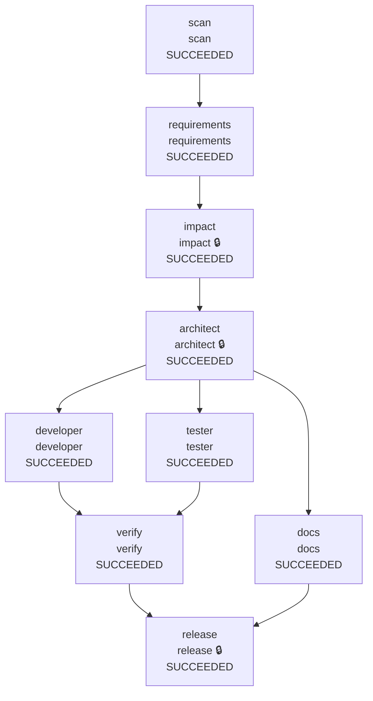

# Warden run report: brownfield (recorded with Gemini, new prompts live)

## Summary

| Run | State | End-to-end latency | Agent executions | Reason |
|---|---|---|---|---|
| brownfield-20261012T202525Z | SUCCEEDED | 531.111s | 12 | - |

## Reliability metrics

| Metric | Value |
|---|---|
| Run success rate | 100% |
| Agent attempts | 12 |
| Attempt success rate | 92% |
| Failed attempts | 1 |
| Retries (rate per attempt) | 0 (0%) |
| Fallbacks to a backup agent | 0 |
| Rollbacks (per run) | 0 (0) |
| Repair loops (failure routed upstream) | 1 |
| Incidents recovered / unrecovered | 1 / 0 |
| MTTR (first failure -> recovery) | 88.438s |
| Policy denials / escalations | 0 / 7 |
| Audit events | 113 |

## Model usage and cost

| Node | Calls | Input tokens | Output tokens | Thinking tokens | Est. cost |
|---|---|---|---|---|---|
| requirements | 1 | 4,200 | 1,720 | 1,409 | $0.0149 |
| impact | 1 | 5,889 | 887 | 1,117 | $0.0119 |
| architect | 1 | 7,611 | 2,499 | 1,248 | $0.0198 |
| docs | 1 | 10,003 | 7,271 | 0 | $0.0348 |
| tester | 2 | 32,780 | 27,248 | 5,337 | $0.1468 |
| developer | 3 | 41,954 | 27,462 | 50,134 | $0.3225 |
| release | 1 | 33,287 | 875 | 1,360 | $0.0333 |
| **total** | 10 | 135,724 | 67,962 | 60,605 | $0.5839 |

Models: gemini-3.8-flash. Cost estimated at list prices in `warden/llm/pricing.py`.
1 call(s) have no thinking-token count (recorded before it was captured), so their cost is understated.

## Workflow

Final state of every node (🔒 = human approval required).

| Node | Final state | Attempts | Failures | Last duration |
|---|---|---|---|---|
| scan | SUCCEEDED | 1 | 0 | 0 ms |
| requirements | SUCCEEDED | 1 | 0 | 22844 ms |
| impact | SUCCEEDED | 1 | 0 | 13577 ms |
| architect | SUCCEEDED | 1 | 0 | 24672 ms |
| developer | SUCCEEDED | 2 | 0 | 49063 ms |
| tester | SUCCEEDED | 2 | 0 | 77531 ms |
| docs | SUCCEEDED | 1 | 0 | 42625 ms |
| verify | SUCCEEDED | 2 | 1 | 10858 ms |
| release | SUCCEEDED | 1 | 0 | 20593 ms |

## Timeline

| t | Node | Event | Detail |
|---|---|---|---|
| +0.0s | - | RUN_STARTED |  |
| +0.0s | scan | READY -> RUNNING | scan |
| +0.0s | scan | RUNNING -> SUCCEEDED |  |
| +0.0s | requirements | READY -> RUNNING | requirements |
| +22.9s | requirements | RUNNING -> AWAITING_APPROVAL |  |
| +22.9s | requirements | approval: approve | human:auto-approve --auto-approve |
| +22.9s | requirements | AWAITING_APPROVAL -> SUCCEEDED |  |
| +22.9s | impact | READY -> RUNNING | impact |
| +36.5s | impact | policy escalate | role 'impact' has autonomy 'supervised' |
| +36.5s | impact | RUNNING -> AWAITING_APPROVAL |  |
| +36.5s | impact | approval: approve | human:auto-approve --auto-approve |
| +36.5s | impact | AWAITING_APPROVAL -> SUCCEEDED |  |
| +36.5s | architect | READY -> RUNNING | architect |
| +61.1s | architect | policy escalate | role 'architect' has autonomy 'supervised' |
| +61.1s | architect | RUNNING -> AWAITING_APPROVAL |  |
| +61.1s | architect | approval: approve | human:auto-approve --auto-approve |
| +61.1s | architect | AWAITING_APPROVAL -> SUCCEEDED |  |
| +61.1s | developer | READY -> RUNNING | developer |
| +61.1s | tester | READY -> RUNNING | tester |
| +61.1s | docs | READY -> RUNNING | docs |
| +103.8s | docs | RUNNING -> SUCCEEDED |  |
| +142.0s | tester | policy escalate | tests.bundle:tests/Tests.csproj matches protected path '*.csproj' |
| +142.0s | tester | RUNNING -> AWAITING_APPROVAL |  |
| +142.0s | tester | approval: approve | human:auto-approve --auto-approve |
| +142.0s | tester | AWAITING_APPROVAL -> SUCCEEDED |  |
| +418.5s | developer | policy escalate | code.bundle:src/App/App.csproj matches protected path '*.csproj'; code.bundle:src/App/appsettings.Development.json matches protected path... |
| +418.5s | developer | RUNNING -> AWAITING_APPROVAL |  |
| +418.5s | developer | approval: approve | human:auto-approve --auto-approve |
| +418.5s | developer | AWAITING_APPROVAL -> SUCCEEDED |  |
| +418.5s | verify | READY -> RUNNING | verify |
| +422.1s | verify | RUNNING -> FAILED | exit gate: build failed (exit 1): ./src/App/Endpoints/LinkEndpoints.cs(46,30): error CS1003: Syntax error, '=>' expected [./src/App/App.c... |
| +422.1s | verify | FAILED -> ROLLED_BACK | exit gate: build failed (exit 1): ./src/App/Endpoints/LinkEndpoints.cs(46,30): error CS1003: Syntax error, '=>' expected [./src/App/App.c... |
| +422.1s | verify | REPLAN | exit gate: build failed (exit 1): ./src/App/Endpoints/LinkEndpoints.cs(46,30): error CS1003: Syntax error, '=>' expected [./src/App/App.c... |
| +422.1s | developer | READY -> RUNNING | developer |
| +422.1s | tester | READY -> RUNNING | tester |
| +471.1s | developer | policy escalate | code.bundle:src/App/App.csproj matches protected path '*.csproj'; code.bundle:src/App/appsettings.Development.json matches protected path... |
| +471.1s | developer | RUNNING -> AWAITING_APPROVAL |  |
| +471.1s | developer | approval: approve | human:auto-approve --auto-approve |
| +471.1s | developer | AWAITING_APPROVAL -> SUCCEEDED |  |
| +499.6s | tester | policy escalate | tests.bundle:tests/Tests.csproj matches protected path '*.csproj' |
| +499.6s | tester | RUNNING -> AWAITING_APPROVAL |  |
| +499.6s | tester | approval: approve | human:auto-approve --auto-approve |
| +499.6s | tester | AWAITING_APPROVAL -> SUCCEEDED |  |
| +499.6s | verify | READY -> RUNNING | verify |
| +510.5s | verify | RUNNING -> SUCCEEDED |  |
| +510.5s | release | READY -> RUNNING | release |
| +531.1s | release | policy escalate | role 'release' has autonomy 'supervised' |
| +531.1s | release | RUNNING -> AWAITING_APPROVAL |  |
| +531.1s | release | approval: approve | human:auto-approve --auto-approve |
| +531.1s | release | AWAITING_APPROVAL -> SUCCEEDED |  |
| +531.1s | - | RUN_FINISHED | SUCCEEDED |

## Human approvals

| Node | Verdict | By | Waited | Why asked | Comment |
|---|---|---|---|---|---|
| requirements | approve | human:auto-approve | 0.001s | agent asks for human input: 2 blocking clarifying question(s) Q1, Q2: answer them with 'changes', or approve to accept the proposed defaults | --auto-approve |
| impact | approve | human:auto-approve | 0.001s | node requires approval; policy: role 'impact' has autonomy 'supervised' | --auto-approve |
| architect | approve | human:auto-approve | 0.003s | node requires approval; policy: role 'architect' has autonomy 'supervised' | --auto-approve |
| tester | approve | human:auto-approve | 0.003s | policy: tests.bundle:tests/Tests.csproj matches protected path '*.csproj' | --auto-approve |
| developer | approve | human:auto-approve | 0.002s | policy: code.bundle:src/App/App.csproj matches protected path '*.csproj'; code.bundle:src/App/appsettings.Development.json matches protec... | --auto-approve |
| developer | approve | human:auto-approve | 0.002s | policy: code.bundle:src/App/App.csproj matches protected path '*.csproj'; code.bundle:src/App/appsettings.Development.json matches protec... | --auto-approve |
| tester | approve | human:auto-approve | 0.002s | policy: tests.bundle:tests/Tests.csproj matches protected path '*.csproj' | --auto-approve |
| release | approve | human:auto-approve | 0.002s | node requires approval; policy: role 'release' has autonomy 'supervised' | --auto-approve |

## Policy decisions

| Node | Phase | Decision | Rule | Reason |
|---|---|---|---|---|
| impact | post | escalate | autonomy | role 'impact' has autonomy 'supervised' |
| architect | post | escalate | autonomy | role 'architect' has autonomy 'supervised' |
| tester | post | escalate | protected_paths | tests.bundle:tests/Tests.csproj matches protected path '*.csproj' |
| developer | post | escalate | protected_paths,scope | code.bundle:src/App/App.csproj matches protected path '*.csproj'; code.bundle:src/App/appsettings.Development.json matches protected path... |
| developer | post | escalate | protected_paths,scope | code.bundle:src/App/App.csproj matches protected path '*.csproj'; code.bundle:src/App/appsettings.Development.json matches protected path... |
| tester | post | escalate | protected_paths | tests.bundle:tests/Tests.csproj matches protected path '*.csproj' |
| release | post | escalate | autonomy | role 'release' has autonomy 'supervised' |

## Decision lineage

The last committed decision (event 111: `release` SUCCEEDED) traces back through 69 causally linked events, including 8 human decision(s):

- event 15: human:auto-approve approve on `requirements`: --auto-approve
- event 25: human:auto-approve approve on `impact`: --auto-approve
- event 35: human:auto-approve approve on `architect`: --auto-approve
- event 55: human:auto-approve approve on `tester`: --auto-approve
- event 62: human:auto-approve approve on `developer`: --auto-approve
- event 86: human:auto-approve approve on `developer`: --auto-approve
- event 93: human:auto-approve approve on `tester`: --auto-approve
- event 109: human:auto-approve approve on `release`: --auto-approve

Artifacts in the chain: `codebase.json@v1`, `spec.json@v1`, `impact.json@v1`, `design.json@v1`, `docs.bundle@v2`, `tests.bundle@v2`, `code.bundle@v2`, `code.bundle@v3`, `tests.bundle@v3`, `verify_report.json@v1`, `release_review.json@v1`

## Audit integrity

Hash chain **verified**: 113 events, head hash `88a174632b07b393...`. Editing, deleting or reordering any event breaks verification.

External anchors: audit head hashes recorded in git commits. A rewritten log cannot reproduce them.

| Commit | Event | Result |
|---|---|---|
| `526d9edd6a` | 112 | matches |
