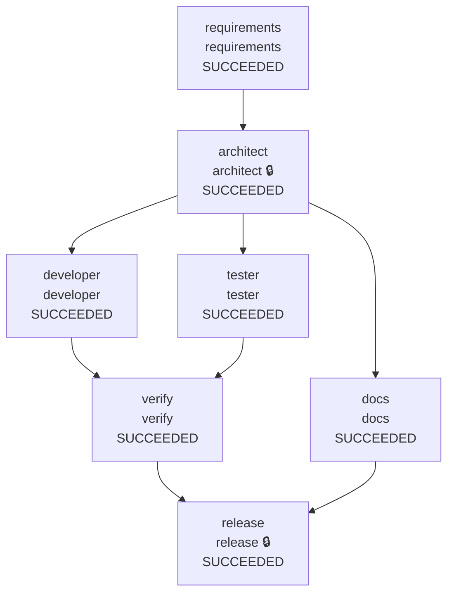

# Warden run report: greenfield (recorded with Gemini, new prompts live)

## Summary

| Run | State | End-to-end latency | Agent executions | Reason |
|---|---|---|---|---|
| greenfield-20261012T200558Z | SUCCEEDED | 1073.96s | 19 | - |

## Reliability metrics

| Metric | Value |
|---|---|
| Run success rate | 100% |
| Agent attempts | 19 |
| Attempt success rate | 79% |
| Failed attempts | 4 |
| Retries (rate per attempt) | 0 (0%) |
| Fallbacks to a backup agent | 0 |
| Rollbacks (per run) | 0 (0) |
| Repair loops (failure routed upstream) | 4 |
| Incidents recovered / unrecovered | 1 / 0 |
| MTTR (first failure -> recovery) | 1040.14s |
| Policy denials / escalations | 0 / 12 |
| Audit events | 190 |

## Model usage and cost

| Node | Calls | Input tokens | Output tokens | Thinking tokens | Est. cost |
|---|---|---|---|---|---|
| requirements | 1 | 1,057 | 1,981 | 1,400 | $0.0135 |
| architect | 1 | 3,841 | 3,483 | 0 | $0.0159 |
| docs | 1 | 6,384 | 5,501 | 0 | $0.0254 |
| developer | 5 | 60,743 | 37,722 | 94,633 | $0.5419 |
| tester | 5 | 63,087 | 40,986 | 76,798 | $0.4890 |
| release | 1 | 26,474 | 1,277 | 1,837 | $0.0315 |
| **total** | 14 | 161,586 | 90,950 | 174,668 | $1.1173 |

Models: gemini-3.8-flash. Cost estimated at list prices in `warden/llm/pricing.py`.
2 call(s) have no thinking-token count (recorded before it was captured), so their cost is understated.

## Workflow

Final state of every node (🔒 = human approval required).

| Node | Final state | Attempts | Failures | Last duration |
|---|---|---|---|---|
| requirements | SUCCEEDED | 1 | 0 | 14 ms |
| architect | SUCCEEDED | 1 | 0 | 15 ms |
| developer | SUCCEEDED | 5 | 0 | 995140 ms |
| tester | SUCCEEDED | 5 | 0 | 0 ms |
| docs | SUCCEEDED | 1 | 0 | 0 ms |
| verify | SUCCEEDED | 5 | 4 | 14047 ms |
| release | SUCCEEDED | 1 | 0 | 17250 ms |

## Timeline

| t | Node | Event | Detail |
|---|---|---|---|
| +0.0s | - | RUN_STARTED |  |
| +0.0s | requirements | READY -> RUNNING | requirements |
| +0.0s | requirements | RUNNING -> AWAITING_APPROVAL |  |
| +0.0s | requirements | approval: approve | human:auto-approve --auto-approve |
| +0.0s | requirements | AWAITING_APPROVAL -> SUCCEEDED |  |
| +0.0s | architect | READY -> RUNNING | architect |
| +0.1s | architect | policy escalate | role 'architect' has autonomy 'supervised' |
| +0.1s | architect | RUNNING -> AWAITING_APPROVAL |  |
| +0.1s | architect | approval: approve | human:auto-approve --auto-approve |
| +0.1s | architect | AWAITING_APPROVAL -> SUCCEEDED |  |
| +0.1s | developer | READY -> RUNNING | developer |
| +0.1s | tester | READY -> RUNNING | tester |
| +0.1s | docs | READY -> RUNNING | docs |
| +0.1s | docs | RUNNING -> SUCCEEDED |  |
| +0.1s | developer | policy escalate | code.bundle:src/App/App.csproj matches protected path '*.csproj'; code.bundle:src/App/appsettings.Development.json matches protected path... |
| +0.1s | developer | RUNNING -> AWAITING_APPROVAL |  |
| +0.1s | developer | approval: approve | human:auto-approve --auto-approve |
| +0.1s | developer | AWAITING_APPROVAL -> SUCCEEDED |  |
| +0.1s | tester | policy escalate | tests.bundle:tests/Tests.csproj matches protected path '*.csproj' |
| +0.1s | tester | RUNNING -> AWAITING_APPROVAL |  |
| +0.1s | tester | approval: approve | human:auto-approve --auto-approve |
| +0.1s | tester | AWAITING_APPROVAL -> SUCCEEDED |  |
| +0.1s | verify | READY -> RUNNING | verify |
| +16.5s | verify | RUNNING -> FAILED | exit gate: tests failed (exit 1): Tests: 31 total, 3 passed, 28 failed. Failures grouped by error (most frequent first): - 28 test(s): Cl... |
| +16.5s | verify | FAILED -> ROLLED_BACK | exit gate: tests failed (exit 1): Tests: 31 total, 3 passed, 28 failed. Failures grouped by error (most frequent first): - 28 test(s): Cl... |
| +16.6s | verify | REPLAN | exit gate: tests failed (exit 1): Tests: 31 total, 3 passed, 28 failed. Failures grouped by error (most frequent first): - 28 test(s): Cl... |
| +16.6s | developer | READY -> RUNNING | developer |
| +16.6s | tester | READY -> RUNNING | tester |
| +16.6s | developer | policy escalate | code.bundle:src/App/App.csproj matches protected path '*.csproj'; code.bundle:src/App/appsettings.Development.json matches protected path... |
| +16.6s | developer | RUNNING -> AWAITING_APPROVAL |  |
| +16.6s | developer | approval: approve | human:auto-approve --auto-approve |
| +16.6s | developer | AWAITING_APPROVAL -> SUCCEEDED |  |
| +16.6s | tester | policy escalate | tests.bundle:tests/Tests.csproj matches protected path '*.csproj' |
| +16.6s | tester | RUNNING -> AWAITING_APPROVAL |  |
| +16.6s | tester | approval: approve | human:auto-approve --auto-approve |
| +16.6s | tester | AWAITING_APPROVAL -> SUCCEEDED |  |
| +16.6s | verify | READY -> RUNNING | verify |
| +26.4s | verify | RUNNING -> FAILED | exit gate: tests failed (exit 1): Tests: 31 total, 3 passed, 28 failed. Failures grouped by error (most frequent first): - 28 test(s): Cl... |
| +26.4s | verify | FAILED -> ROLLED_BACK | exit gate: tests failed (exit 1): Tests: 31 total, 3 passed, 28 failed. Failures grouped by error (most frequent first): - 28 test(s): Cl... |
| +26.4s | verify | REPLAN | exit gate: tests failed (exit 1): Tests: 31 total, 3 passed, 28 failed. Failures grouped by error (most frequent first): - 28 test(s): Cl... |
| +26.4s | developer | READY -> RUNNING | developer |
| +26.5s | tester | READY -> RUNNING | tester |
| +26.5s | developer | policy escalate | code.bundle:src/App/App.csproj matches protected path '*.csproj'; code.bundle:src/App/appsettings.Development.json matches protected path... |
| +26.5s | developer | RUNNING -> AWAITING_APPROVAL |  |
| +26.5s | developer | approval: approve | human:auto-approve --auto-approve |
| +26.5s | developer | AWAITING_APPROVAL -> SUCCEEDED |  |
| +26.5s | tester | policy escalate | tests.bundle:tests/Tests.csproj matches protected path '*.csproj' |
| +26.5s | tester | RUNNING -> AWAITING_APPROVAL |  |
| +26.5s | tester | approval: approve | human:auto-approve --auto-approve |
| +26.5s | tester | AWAITING_APPROVAL -> SUCCEEDED |  |
| +26.5s | verify | READY -> RUNNING | verify |
| +36.0s | verify | RUNNING -> FAILED | exit gate: tests failed (exit 1): Tests: 31 total, 27 passed, 4 failed. Failures grouped by error (most frequent first): - 3 test(s): Mic... |
| +36.0s | verify | FAILED -> ROLLED_BACK | exit gate: tests failed (exit 1): Tests: 31 total, 27 passed, 4 failed. Failures grouped by error (most frequent first): - 3 test(s): Mic... |
| +36.0s | verify | REPLAN | exit gate: tests failed (exit 1): Tests: 31 total, 27 passed, 4 failed. Failures grouped by error (most frequent first): - 3 test(s): Mic... |
| +36.0s | developer | READY -> RUNNING | developer |
| +36.0s | tester | READY -> RUNNING | tester |
| +36.1s | developer | policy escalate | code.bundle:src/App/App.csproj matches protected path '*.csproj'; code.bundle:src/App/appsettings.Development.json matches protected path... |
| +36.1s | developer | RUNNING -> AWAITING_APPROVAL |  |
| +36.1s | developer | approval: approve | human:auto-approve --auto-approve |
| +36.1s | developer | AWAITING_APPROVAL -> SUCCEEDED |  |
| +36.1s | tester | policy escalate | tests.bundle:tests/Tests.csproj matches protected path '*.csproj' |
| +36.1s | tester | RUNNING -> AWAITING_APPROVAL |  |
| +36.1s | tester | approval: approve | human:auto-approve --auto-approve |
| +36.1s | tester | AWAITING_APPROVAL -> SUCCEEDED |  |
| +36.1s | verify | READY -> RUNNING | verify |
| +45.5s | verify | RUNNING -> FAILED | exit gate: tests failed (exit 1): Tests: 31 total, 30 passed, 1 failed. Failures grouped by error (most frequent first): - 1 test(s): Ass... |
| +45.5s | verify | FAILED -> ROLLED_BACK | exit gate: tests failed (exit 1): Tests: 31 total, 30 passed, 1 failed. Failures grouped by error (most frequent first): - 1 test(s): Ass... |
| +45.5s | verify | REPLAN | exit gate: tests failed (exit 1): Tests: 31 total, 30 passed, 1 failed. Failures grouped by error (most frequent first): - 1 test(s): Ass... |
| +45.6s | developer | READY -> RUNNING | developer |
| +45.6s | tester | READY -> RUNNING | tester |
| +45.6s | tester | policy escalate | tests.bundle:tests/Tests.csproj matches protected path '*.csproj' |
| +45.6s | tester | RUNNING -> AWAITING_APPROVAL |  |
| +45.6s | tester | approval: approve | human:auto-approve --auto-approve |
| +45.6s | tester | AWAITING_APPROVAL -> SUCCEEDED |  |
| +1042.6s | developer | policy escalate | code.bundle:src/App/App.csproj matches protected path '*.csproj'; code.bundle:src/App/appsettings.Development.json matches protected path... |
| +1042.6s | developer | RUNNING -> AWAITING_APPROVAL |  |
| +1042.6s | developer | approval: approve | human:auto-approve --auto-approve |
| +1042.6s | developer | AWAITING_APPROVAL -> SUCCEEDED |  |
| +1042.6s | verify | READY -> RUNNING | verify |
| +1056.7s | verify | RUNNING -> SUCCEEDED |  |
| +1056.7s | release | READY -> RUNNING | release |
| +1074.0s | release | policy escalate | role 'release' has autonomy 'supervised' |
| +1074.0s | release | RUNNING -> AWAITING_APPROVAL |  |
| +1074.0s | release | approval: approve | human:auto-approve --auto-approve |
| +1074.0s | release | AWAITING_APPROVAL -> SUCCEEDED |  |
| +1074.0s | - | RUN_FINISHED | SUCCEEDED |

## Human approvals

| Node | Verdict | By | Waited | Why asked | Comment |
|---|---|---|---|---|---|
| requirements | approve | human:auto-approve | 0.001s | agent asks for human input: 3 blocking clarifying question(s) Q1, Q2, Q4: answer them with 'changes', or approve to accept the proposed d... | --auto-approve |
| architect | approve | human:auto-approve | 0.002s | node requires approval; policy: role 'architect' has autonomy 'supervised' | --auto-approve |
| developer | approve | human:auto-approve | 0.002s | policy: code.bundle:src/App/App.csproj matches protected path '*.csproj'; code.bundle:src/App/appsettings.Development.json matches protec... | --auto-approve |
| tester | approve | human:auto-approve | 0.002s | policy: tests.bundle:tests/Tests.csproj matches protected path '*.csproj' | --auto-approve |
| developer | approve | human:auto-approve | 0.004s | policy: code.bundle:src/App/App.csproj matches protected path '*.csproj'; code.bundle:src/App/appsettings.Development.json matches protec... | --auto-approve |
| tester | approve | human:auto-approve | 0.002s | policy: tests.bundle:tests/Tests.csproj matches protected path '*.csproj' | --auto-approve |
| developer | approve | human:auto-approve | 0.003s | policy: code.bundle:src/App/App.csproj matches protected path '*.csproj'; code.bundle:src/App/appsettings.Development.json matches protec... | --auto-approve |
| tester | approve | human:auto-approve | 0.003s | policy: tests.bundle:tests/Tests.csproj matches protected path '*.csproj' | --auto-approve |
| developer | approve | human:auto-approve | 0.003s | policy: code.bundle:src/App/App.csproj matches protected path '*.csproj'; code.bundle:src/App/appsettings.Development.json matches protec... | --auto-approve |
| tester | approve | human:auto-approve | 0.002s | policy: tests.bundle:tests/Tests.csproj matches protected path '*.csproj' | --auto-approve |
| tester | approve | human:auto-approve | 0.002s | policy: tests.bundle:tests/Tests.csproj matches protected path '*.csproj' | --auto-approve |
| developer | approve | human:auto-approve | 0.002s | policy: code.bundle:src/App/App.csproj matches protected path '*.csproj'; code.bundle:src/App/appsettings.Development.json matches protec... | --auto-approve |
| release | approve | human:auto-approve | 0.002s | node requires approval; policy: role 'release' has autonomy 'supervised' | --auto-approve |

## Policy decisions

| Node | Phase | Decision | Rule | Reason |
|---|---|---|---|---|
| architect | post | escalate | autonomy | role 'architect' has autonomy 'supervised' |
| developer | post | escalate | protected_paths | code.bundle:src/App/App.csproj matches protected path '*.csproj'; code.bundle:src/App/appsettings.Development.json matches protected path... |
| tester | post | escalate | protected_paths | tests.bundle:tests/Tests.csproj matches protected path '*.csproj' |
| developer | post | escalate | protected_paths | code.bundle:src/App/App.csproj matches protected path '*.csproj'; code.bundle:src/App/appsettings.Development.json matches protected path... |
| tester | post | escalate | protected_paths | tests.bundle:tests/Tests.csproj matches protected path '*.csproj' |
| developer | post | escalate | protected_paths | code.bundle:src/App/App.csproj matches protected path '*.csproj'; code.bundle:src/App/appsettings.Development.json matches protected path... |
| tester | post | escalate | protected_paths | tests.bundle:tests/Tests.csproj matches protected path '*.csproj' |
| developer | post | escalate | protected_paths | code.bundle:src/App/App.csproj matches protected path '*.csproj'; code.bundle:src/App/appsettings.Development.json matches protected path... |
| tester | post | escalate | protected_paths | tests.bundle:tests/Tests.csproj matches protected path '*.csproj' |
| tester | post | escalate | protected_paths | tests.bundle:tests/Tests.csproj matches protected path '*.csproj' |
| developer | post | escalate | protected_paths | code.bundle:src/App/App.csproj matches protected path '*.csproj'; code.bundle:src/App/appsettings.Development.json matches protected path... |
| release | post | escalate | autonomy | role 'release' has autonomy 'supervised' |

## Decision lineage

The last committed decision (event 188: `release` SUCCEEDED) traces back through 122 causally linked events, including 13 human decision(s):

- event 9: human:auto-approve approve on `requirements`: --auto-approve
- event 19: human:auto-approve approve on `architect`: --auto-approve
- event 39: human:auto-approve approve on `developer`: --auto-approve
- event 46: human:auto-approve approve on `tester`: --auto-approve
- event 70: human:auto-approve approve on `developer`: --auto-approve
- event 77: human:auto-approve approve on `tester`: --auto-approve
- event 101: human:auto-approve approve on `developer`: --auto-approve
- event 108: human:auto-approve approve on `tester`: --auto-approve
- event 132: human:auto-approve approve on `developer`: --auto-approve
- event 139: human:auto-approve approve on `tester`: --auto-approve
- event 163: human:auto-approve approve on `tester`: --auto-approve
- event 170: human:auto-approve approve on `developer`: --auto-approve
- event 186: human:auto-approve approve on `release`: --auto-approve

Artifacts in the chain: `spec.json@v1`, `design.json@v1`, `docs.bundle@v1`, `code.bundle@v1`, `tests.bundle@v1`, `code.bundle@v1`, `tests.bundle@v2`, `code.bundle@v2`, `tests.bundle@v3`, `code.bundle@v3`, `tests.bundle@v4`, `tests.bundle@v5`, `code.bundle@v4`, `verify_report.json@v1`, `release_review.json@v1`

## Audit integrity

Hash chain **verified**: 190 events, head hash `e5a0ad810358a7d2...`. Editing, deleting or reordering any event breaks verification.

External anchors: audit head hashes recorded in git commits. A rewritten log cannot reproduce them.

| Commit | Event | Result |
|---|---|---|
| `c2482077cf` | 189 | matches |
