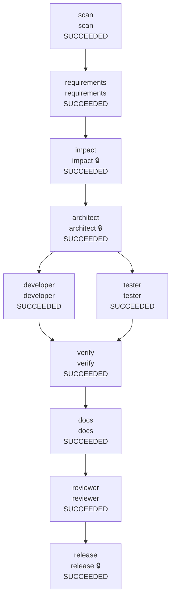

# Warden run report: harden (recorded with Gemini, new prompts live)

## Summary

| Run | State | End-to-end latency | Agent executions | Reason |
|---|---|---|---|---|
| harden-20261013T183654Z | SUCCEEDED | 248.411s | 24 | - |

## Reliability metrics

| Metric | Value |
|---|---|
| Run success rate | 100% |
| Agent attempts | 24 |
| Attempt success rate | 71% |
| Failed attempts | 7 |
| Retries (rate per attempt) | 4 (17%) |
| Fallbacks to a backup agent | 0 |
| Rollbacks (per run) | 0 (0) |
| Repair loops (failure routed upstream) | 3 |
| Incidents recovered / unrecovered | 5 / 0 |
| MTTR (first failure -> recovery) | 58.331s |
| Policy denials / escalations | 0 / 10 |
| Audit events | 220 |

## Model usage and cost

| Node | Calls | Input tokens | Output tokens | Thinking tokens | Est. cost |
|---|---|---|---|---|---|
| requirements | 1 | 5,162 | 1,640 | 996 | $0.0138 |
| impact | 1 | 6,314 | 582 | 3,173 | $0.0188 |
| architect | 1 | 7,989 | 2,860 | 1,163 | $0.0211 |
| developer | 6 | 100,779 | 66,910 | 156,882 | $0.9148 |
| tester | 3 | 61,964 | 49,389 | 48,571 | $0.4138 |
| docs | 4 | 150,354 | 15,750 | 10,204 | $0.2101 |
| reviewer | 2 | 77,668 | 319 | 13,097 | $0.1086 |
| release | 1 | 39,332 | 993 | 898 | $0.0366 |
| **total** | 19 | 449,562 | 138,443 | 234,984 | $1.7375 |

Models: gemini-3.8-flash. Cost estimated at list prices in `warden/llm/pricing.py`.

## Workflow

Final state of every node (🔒 = human approval required).

| Node | Final state | Attempts | Failures | Last duration |
|---|---|---|---|---|
| scan | SUCCEEDED | 1 | 0 | 16 ms |
| requirements | SUCCEEDED | 1 | 0 | 32 ms |
| impact | SUCCEEDED | 1 | 0 | 15 ms |
| architect | SUCCEEDED | 1 | 0 | 15 ms |
| developer | SUCCEEDED | 4 | 0 | 0 ms |
| tester | SUCCEEDED | 3 | 0 | 15 ms |
| verify | SUCCEEDED | 4 | 2 | 10328 ms |
| docs | SUCCEEDED | 4 | 2 | 75406 ms |
| reviewer | SUCCEEDED | 2 | 1 | 30952 ms |
| release | SUCCEEDED | 3 | 2 | 33218 ms |

## Timeline

| t | Node | Event | Detail |
|---|---|---|---|
| +0.0s | - | RUN_STARTED |  |
| +0.0s | scan | READY -> RUNNING | scan |
| +0.0s | scan | RUNNING -> SUCCEEDED |  |
| +0.0s | requirements | READY -> RUNNING | requirements |
| +0.1s | requirements | RUNNING -> AWAITING_APPROVAL |  |
| +0.1s | requirements | approval: approve | human:auto-approve --auto-approve |
| +0.1s | requirements | AWAITING_APPROVAL -> SUCCEEDED |  |
| +0.1s | impact | READY -> RUNNING | impact |
| +0.1s | impact | policy escalate | role 'impact' has autonomy 'supervised' |
| +0.1s | impact | RUNNING -> AWAITING_APPROVAL |  |
| +0.1s | impact | approval: approve | human:auto-approve --auto-approve |
| +0.1s | impact | AWAITING_APPROVAL -> SUCCEEDED |  |
| +0.1s | architect | READY -> RUNNING | architect |
| +0.1s | architect | policy escalate | role 'architect' has autonomy 'supervised' |
| +0.1s | architect | RUNNING -> AWAITING_APPROVAL |  |
| +0.1s | architect | approval: approve | human:auto-approve --auto-approve |
| +0.1s | architect | AWAITING_APPROVAL -> SUCCEEDED |  |
| +0.2s | developer | READY -> RUNNING | developer |
| +0.2s | tester | READY -> RUNNING | tester |
| +0.2s | developer | policy escalate | code.bundle:src/App/App.csproj matches protected path '*.csproj'; code.bundle:src/App/Data/Migrations/InitialCreate.cs matches protected ... |
| +0.2s | developer | RUNNING -> AWAITING_APPROVAL |  |
| +0.2s | tester | policy escalate | tests.bundle:tests/Tests.csproj matches protected path '*.csproj' |
| +0.2s | tester | RUNNING -> AWAITING_APPROVAL |  |
| +0.2s | developer | approval: approve | human:auto-approve --auto-approve |
| +0.3s | developer | AWAITING_APPROVAL -> SUCCEEDED |  |
| +0.3s | tester | approval: approve | human:auto-approve --auto-approve |
| +0.3s | tester | AWAITING_APPROVAL -> SUCCEEDED |  |
| +0.3s | verify | READY -> RUNNING | verify |
| +5.5s | verify | RUNNING -> FAILED | exit gate: build failed (exit 1): ./src/App/Services/LinkService.cs(180,41): error CS1061: '<anonymous type: long Id, string OriginalUrl,... |
| +5.5s | verify | FAILED -> ROLLED_BACK | exit gate: build failed (exit 1): ./src/App/Services/LinkService.cs(180,41): error CS1061: '<anonymous type: long Id, string OriginalUrl,... |
| +5.5s | verify | REPLAN | exit gate: build failed (exit 1): ./src/App/Services/LinkService.cs(180,41): error CS1061: '<anonymous type: long Id, string OriginalUrl,... |
| +5.5s | developer | READY -> RUNNING | developer |
| +5.5s | tester | READY -> RUNNING | tester |
| +5.6s | tester | policy escalate | tests.bundle:tests/Tests.csproj matches protected path '*.csproj' |
| +5.6s | tester | RUNNING -> AWAITING_APPROVAL |  |
| +5.6s | tester | approval: approve | human:auto-approve --auto-approve |
| +5.6s | tester | AWAITING_APPROVAL -> SUCCEEDED |  |
| +5.6s | developer | policy escalate | code.bundle:src/App/App.csproj matches protected path '*.csproj'; code.bundle:src/App/Data/Migrations/InitialCreate.cs matches protected ... |
| +5.6s | developer | RUNNING -> AWAITING_APPROVAL |  |
| +5.6s | developer | approval: approve | human:auto-approve --auto-approve |
| +5.6s | developer | AWAITING_APPROVAL -> SUCCEEDED |  |
| +5.6s | verify | READY -> RUNNING | verify |
| +16.7s | verify | RUNNING -> FAILED | exit gate: tests failed (exit 1): Tests: 52 total, 49 passed, 3 failed. Failures grouped by error (most frequent first): - 1 test(s): Ass... |
| +16.7s | verify | FAILED -> ROLLED_BACK | exit gate: tests failed (exit 1): Tests: 52 total, 49 passed, 3 failed. Failures grouped by error (most frequent first): - 1 test(s): Ass... |
| +16.7s | verify | REPLAN | exit gate: tests failed (exit 1): Tests: 52 total, 49 passed, 3 failed. Failures grouped by error (most frequent first): - 1 test(s): Ass... |
| +16.7s | developer | READY -> RUNNING | developer |
| +16.7s | tester | READY -> RUNNING | tester |
| +16.7s | developer | policy escalate | code.bundle:src/App/App.csproj matches protected path '*.csproj'; code.bundle:src/App/Data/Migrations/InitialCreate.cs matches protected ... |
| +16.7s | developer | RUNNING -> AWAITING_APPROVAL |  |
| +16.7s | tester | policy escalate | tests.bundle:tests/Tests.csproj matches protected path '*.csproj' |
| +16.7s | tester | RUNNING -> AWAITING_APPROVAL |  |
| +16.7s | developer | approval: approve | human:auto-approve --auto-approve |
| +16.7s | developer | AWAITING_APPROVAL -> SUCCEEDED |  |
| +16.7s | tester | approval: approve | human:auto-approve --auto-approve |
| +16.7s | tester | AWAITING_APPROVAL -> SUCCEEDED |  |
| +16.8s | verify | READY -> RUNNING | verify |
| +26.9s | verify | RUNNING -> SUCCEEDED |  |
| +26.9s | docs | READY -> RUNNING | docs |
| +27.0s | docs | RUNNING -> FAILED | agent error: AgentOutputError: docs: invalid output after 2 attempt(s): (root): Invalid JSON: trailing characters at line 5 column 3 |
| +27.0s | docs | RETRY_SCHEDULED | agent error: AgentOutputError: docs: invalid output after 2 attempt(s): (root): Invalid JSON: trailing characters at line 5 column 3 |
| +27.0s | docs | READY -> RUNNING | docs |
| +27.0s | docs | RUNNING -> SUCCEEDED |  |
| +27.0s | reviewer | READY -> RUNNING | reviewer |
| +27.0s | reviewer | RUNNING -> FAILED | exit gate: consistency review: 2 blocking finding(s) - [developer] claim: the schema can change between releases \| reality: EnsureCreate... |
| +27.0s | reviewer | FAILED -> ROLLED_BACK | exit gate: consistency review: 2 blocking finding(s) - [developer] claim: the schema can change between releases \| reality: EnsureCreate... |
| +27.0s | reviewer | REPLAN | exit gate: consistency review: 2 blocking finding(s) - [developer] claim: the schema can change between releases \| reality: EnsureCreate... |
| +27.0s | developer | READY -> RUNNING | developer |
| +27.1s | developer | policy escalate | code.bundle:src/App/App.csproj matches protected path '*.csproj'; code.bundle:src/App/Data/Migrations/InitialCreate.cs matches protected ... |
| +27.1s | developer | RUNNING -> AWAITING_APPROVAL |  |
| +27.1s | developer | approval: approve | human:auto-approve --auto-approve |
| +27.1s | developer | AWAITING_APPROVAL -> SUCCEEDED |  |
| +27.1s | verify | READY -> RUNNING | verify |
| +37.4s | verify | RUNNING -> SUCCEEDED |  |
| +37.4s | docs | READY -> RUNNING | docs |
| +63.7s | docs | RUNNING -> FAILED | agent error: LLMTransientError: gemini HTTP 503: This model is currently experiencing high demand. Spikes in demand are usually temporary... |
| +63.7s | docs | RETRY_SCHEDULED | agent error: LLMTransientError: gemini HTTP 503: This model is currently experiencing high demand. Spikes in demand are usually temporary... |
| +63.7s | docs | READY -> RUNNING | docs |
| +139.2s | docs | RUNNING -> SUCCEEDED |  |
| +139.2s | reviewer | READY -> RUNNING | reviewer |
| +170.1s | reviewer | RUNNING -> SUCCEEDED |  |
| +170.1s | release | READY -> RUNNING | release |
| +196.8s | release | RUNNING -> FAILED | agent error: LLMTransientError: gemini HTTP 503: This model is currently experiencing high demand. Spikes in demand are usually temporary... |
| +196.8s | release | RETRY_SCHEDULED | agent error: LLMTransientError: gemini HTTP 503: This model is currently experiencing high demand. Spikes in demand are usually temporary... |
| +196.8s | release | READY -> RUNNING | release |
| +215.2s | release | RUNNING -> FAILED | agent error: LLMTransientError: gemini HTTP 429: You exceeded your current quota, please check your plan and billing details. For more in... |
| +215.2s | release | RETRY_SCHEDULED | agent error: LLMTransientError: gemini HTTP 429: You exceeded your current quota, please check your plan and billing details. For more in... |
| +215.2s | release | READY -> RUNNING | release |
| +248.4s | release | policy escalate | role 'release' has autonomy 'supervised' |
| +248.4s | release | RUNNING -> AWAITING_APPROVAL |  |
| +248.4s | release | approval: approve | human:auto-approve --auto-approve |
| +248.4s | release | AWAITING_APPROVAL -> SUCCEEDED |  |
| +248.4s | - | RUN_FINISHED | SUCCEEDED |

## Human approvals

| Node | Verdict | By | Waited | Why asked | Comment |
|---|---|---|---|---|---|
| requirements | approve | human:auto-approve | 0.002s | agent asks for human input: 1 blocking clarifying question(s) Q1: answer them with 'changes', or approve to accept the proposed defaults | --auto-approve |
| impact | approve | human:auto-approve | 0.002s | node requires approval; policy: role 'impact' has autonomy 'supervised' | --auto-approve |
| architect | approve | human:auto-approve | 0.002s | node requires approval; policy: role 'architect' has autonomy 'supervised' | --auto-approve |
| developer | approve | human:auto-approve | 0.048s | policy: code.bundle:src/App/App.csproj matches protected path '*.csproj'; code.bundle:src/App/Data/Migrations/InitialCreate.cs matches pr... | --auto-approve |
| tester | approve | human:auto-approve | 0.022s | policy: tests.bundle:tests/Tests.csproj matches protected path '*.csproj' | --auto-approve |
| tester | approve | human:auto-approve | 0.003s | policy: tests.bundle:tests/Tests.csproj matches protected path '*.csproj' | --auto-approve |
| developer | approve | human:auto-approve | 0.003s | policy: code.bundle:src/App/App.csproj matches protected path '*.csproj'; code.bundle:src/App/Data/Migrations/InitialCreate.cs matches pr... | --auto-approve |
| developer | approve | human:auto-approve | 0.019s | policy: code.bundle:src/App/App.csproj matches protected path '*.csproj'; code.bundle:src/App/Data/Migrations/InitialCreate.cs matches pr... | --auto-approve |
| tester | approve | human:auto-approve | 0.006s | policy: tests.bundle:tests/Tests.csproj matches protected path '*.csproj' | --auto-approve |
| developer | approve | human:auto-approve | 0.001s | policy: code.bundle:src/App/App.csproj matches protected path '*.csproj'; code.bundle:src/App/Data/Migrations/InitialCreate.cs matches pr... | --auto-approve |
| release | approve | human:auto-approve | 0.003s | node requires approval; policy: role 'release' has autonomy 'supervised' | --auto-approve |

## Policy decisions

| Node | Phase | Decision | Rule | Reason |
|---|---|---|---|---|
| impact | post | escalate | autonomy | role 'impact' has autonomy 'supervised' |
| architect | post | escalate | autonomy | role 'architect' has autonomy 'supervised' |
| developer | post | escalate | protected_paths,scope | code.bundle:src/App/App.csproj matches protected path '*.csproj'; code.bundle:src/App/Data/Migrations/InitialCreate.cs matches protected ... |
| tester | post | escalate | protected_paths | tests.bundle:tests/Tests.csproj matches protected path '*.csproj' |
| tester | post | escalate | protected_paths | tests.bundle:tests/Tests.csproj matches protected path '*.csproj' |
| developer | post | escalate | protected_paths,scope | code.bundle:src/App/App.csproj matches protected path '*.csproj'; code.bundle:src/App/Data/Migrations/InitialCreate.cs matches protected ... |
| developer | post | escalate | protected_paths,scope | code.bundle:src/App/App.csproj matches protected path '*.csproj'; code.bundle:src/App/Data/Migrations/InitialCreate.cs matches protected ... |
| tester | post | escalate | protected_paths | tests.bundle:tests/Tests.csproj matches protected path '*.csproj' |
| developer | post | escalate | protected_paths,scope | code.bundle:src/App/App.csproj matches protected path '*.csproj'; code.bundle:src/App/Data/Migrations/InitialCreate.cs matches protected ... |
| release | post | escalate | autonomy | role 'release' has autonomy 'supervised' |

## Decision lineage

The last committed decision (event 218: `release` SUCCEEDED) traces back through 131 causally linked events, including 11 human decision(s):

- event 15: human:auto-approve approve on `requirements`: --auto-approve
- event 26: human:auto-approve approve on `impact`: --auto-approve
- event 37: human:auto-approve approve on `architect`: --auto-approve
- event 55: human:auto-approve approve on `developer`: --auto-approve
- event 59: human:auto-approve approve on `tester`: --auto-approve
- event 84: human:auto-approve approve on `tester`: --auto-approve
- event 92: human:auto-approve approve on `developer`: --auto-approve
- event 121: human:auto-approve approve on `developer`: --auto-approve
- event 125: human:auto-approve approve on `tester`: --auto-approve
- event 169: human:auto-approve approve on `developer`: --auto-approve
- event 215: human:auto-approve approve on `release`: --auto-approve

Artifacts in the chain: `codebase.json@v1`, `spec.json@v1`, `impact.json@v1`, `design.json@v1`, `code.bundle@v2`, `tests.bundle@v2`, `tests.bundle@v3`, `code.bundle@v3`, `code.bundle@v4`, `tests.bundle@v4`, `verify_report.json@v1`, `docs.bundle@v2`, `code.bundle@v5`, `verify_report.json@v1`, `docs.bundle@v3`, `review.json@v1`, `release_review.json@v1`

## Audit integrity

Hash chain **verified**: 220 events, head hash `40be1f64c37ca9fc...`. Editing, deleting or reordering any event breaks verification.

External anchors: audit head hashes recorded in git commits. A rewritten log cannot reproduce them.

| Commit | Event | Result |
|---|---|---|
| `54aee01115` | 219 | matches |
